# Emotion-Driven Cross-Modal Generation (Art & Music)

> **College Artificial Intelligence & Deep Learning Course Project**  
> An end-to-end bi-directional generative AI system bridging Visual Arts, Symbolic Audio, and Generative Latent Diffusion through Emotional Semantics.

---

## 📌 Project Overview

Human emotions naturally connect distinct sensory modalities: a bright, energetic painting inspires fast, upbeat music; a slow, melancholic cello melody evokes images of rainy, muted landscapes. 

This project implements a **Bi-directional Cross-Modal AI Pipeline**:
1. **Art → Music (Visual to Symbolic Audio):**  
   Accepts an image, classifies its emotional mood (`joyful`, `sad`, `calm`, `energetic`) using **OpenAI's CLIP** (Zero-Shot Image Classification), and algorithmically synthesizes a synchronized 15-second **MIDI composition** via `midiutil`.
2. **Music → Art (Acoustic to Generative Visuals):**  
   Accepts an audio file (`.wav` or `.mp3`), extracts psychoacoustic features (**Tempo/BPM** and **Spectral Centroid**) using **Librosa**, classifies the mood, generates a rich descriptive prompt, and renders high-resolution artwork using **Stable Diffusion Turbo (SD-Turbo)**.

---

## 🏗️ System Architecture

```mermaid
flowchart TD
    subgraph Pipeline1["Pipeline 1: Art ➔ Music (Image to MIDI)"]
        A[Input Image] --> B[OpenAI CLIP ViT-B/32]
        B --> C{Zero-Shot Emotion Classifier}
        C -->|Scores| D[Emotion Class: Joyful / Sad / Calm / Energetic]
        D --> E[Algorithmic MIDI Composer]
        E -->|Tempo, Scale, Velocity| F[15-Second MIDI File .mid]
    end

    subgraph Pipeline2["Pipeline 2: Music ➔ Art (Audio to Painting)"]
        G[Input Audio .wav/.mp3] --> H[Librosa Signal Processing]
        H --> I[Onset Strength ➔ Tempo BPM]
        H --> J[Spectral Centroid ➔ Brightness Hz]
        I & J --> K{Acoustic Emotion Decision Logic}
        K --> L[Emotion Class]
        L --> M[Aesthetic Prompt Synthesizer]
        M --> N[Stable Diffusion Turbo SD-Turbo]
        N --> O[Synthesized Artwork Image]
    end
```



---

## 📁 Repository Structure

```text
emotion_crossmodal_ai/
│
├── requirements.txt      # List of required Python packages and versions
├── art_to_music.py       # Module 1: Image -> CLIP -> Emotion -> MIDI Generator
├── music_to_art.py       # Module 2: Audio -> Librosa -> Emotion -> SD-Turbo Art
├── app.py                # Main Gradio Web Interface (Tabbed Blocks)
└── README.md             # Project documentation, setup guide, and viva reference
```

---

## ⚙️ Installation & Setup

### 1. Prerequisites
- **Python:** Version 3.9, 3.10, 3.11, or 3.12 (Python 3.10+ recommended)
- **Git** (optional, for cloning)
- **Hardware:**
  - Works on standard **CPU** (automatic fast fallback mode enabled).
  - An NVIDIA GPU with CUDA provides faster diffusion synthesis (1-2 seconds per image).

---

### 2. Local Setup (Windows / macOS / Linux)

#### Step 1: Open Terminal / PowerShell and Navigate to the Project
```bash
cd path/to/emotion_crossmodal_ai
```

#### Step 2: Create and Activate a Virtual Environment
- **Windows (PowerShell):**
  ```powershell
  python -m venv venv
  .\venv\Scripts\Activate.ps1
  ```
- **macOS / Linux:**
  ```bash
  python3 -m venv venv
  source venv/bin/activate
  ```

#### Step 3: Install Required Libraries
```bash
pip install --upgrade pip
pip install -r requirements.txt
```

> **Note for PyTorch with CUDA (Optional for GPU Users):**  
> If you have an NVIDIA GPU and want full GPU acceleration, install the official CUDA-enabled PyTorch build from [pytorch.org](https://pytorch.org):
> ```bash
> pip install torch torchvision --index-url https://download.pytorch.org/whl/cu121
> ```

---

### 3. Running the Web Application

Launch the unified Gradio web interface:
```bash
python app.py
```

- Open your browser and navigate to: **`http://127.0.0.1:7860`**
- By default, `share=True` is enabled, which also provides a public temporary link (e.g., `https://xxxx.gradio.live`) to test from mobile or share with your professor.

---

### 4. Running Standalone Modules via Command Line

Each module can also be tested independently from the terminal:

- **Test Art to Music standalone:**
  ```bash
  python art_to_music.py [optional_path_to_image.jpg]
  ```
  *(If no image is passed, a sample image is generated automatically and converted to a `.mid` file).*

- **Test Music to Art standalone:**
  ```bash
  python music_to_art.py [optional_path_to_audio.wav]
  ```
  *(If no audio is passed, a sample audio tone is generated and converted into an AI painting).*

---

## 🌐 Running on Google Colab (One-Click Guide)

Google Colab provides **free T4 GPUs**, which makes running Stable Diffusion Turbo ultra-fast (~1 second per painting!).

### Step-by-Step Colab Instructions:
1. Open [Google Colab](https://colab.research.google.com).
2. Enable GPU: Navigate to **Runtime** → **Change runtime type** → Select **T4 GPU** → Click **Save**.
3. Create a code cell and run the following setup commands:

```python
# 1. Clone or download project files (or upload art_to_music.py, music_to_art.py, app.py, requirements.txt)
# 2. Install dependencies
!pip install -r requirements.txt

# 3. Launch the Gradio Web App with public shareable link
!python app.py --share
```

4. Click the generated **public URL** (`https://xxxx.gradio.live`) output in the Colab cell to open the web app.

---

## 🔬 Technical Explanation (For Viva & Course Evaluation)

### 1. Vision-Language Emotion Extraction (CLIP)
- **Model:** `openai/clip-vit-base-patch32` (ViT Vision Transformer + Transformer Text Encoder).
- **Zero-Shot Mechanism:** CLIP is trained contrastively on 400M (image, text) pairs. To detect emotion without fine-tuning:
  1. The input image is converted into visual latent vector $\mathbf{v} \in \mathbb{R}^{512}$.
  2. The candidate labels (`"joyful"`, `"sad"`, `"calm"`, `"energetic"`) are encoded into text latent vectors $\mathbf{t}_i \in \mathbb{R}^{512}$.
  3. Softmax is applied over the cosine similarity:
     $$P(\text{emotion}_i \mid \text{image}) = \frac{\exp(\cos(\mathbf{v}, \mathbf{t}_i) / \tau)}{\sum_j \exp(\cos(\mathbf{v}, \mathbf{t}_j) / \tau)}$$

### 2. Algorithmic Symbolic Music Composition (`midiutil`)
- **Symbolic vs Audio Waveform:** Rather than generating raw audio (which requires gigabytes of data and high latency), we generate symbolic **MIDI (Musical Instrument Digital Interface)** instructions containing pitch numbers, note durations, and velocity (loudness).
- **Emotion-to-Music Rules:**
  | Emotion | Tempo (BPM) | Musical Scale / Key | Rhythmic Density | Dynamics (Velocity) |
  | :--- | :--- | :--- | :--- | :--- |
  | **Joyful** | 130 BPM | C Major (Ionian) | Upbeat 8th/Quarter notes | 85 – 110 |
  | **Energetic** | 140 BPM | G Major / Mixolydian | Rapid 16th/8th notes | 95 – 120 |
  | **Calm** | 72 BPM | C Major Pentatonic | Half / Whole notes | 50 – 70 |
  | **Sad** | 65 BPM | A Natural Minor (Aeolian) | Sustained legato | 45 – 65 |

### 3. Audio Signal Processing (`librosa`)
- **Tempo (BPM):** Computed by finding periodic peaks in the **Onset Strength Envelope** (representing musical note attacks).
- **Spectral Centroid ($f_c$):** Represents the "center of gravity" of the audio frequencies, mathematically defined as:
  $$f_c = \frac{\sum_{k=0}^{N-1} S(k) \cdot f(k)}{\sum_{k=0}^{N-1} S(k)}$$
  Where $S(k)$ is the magnitude of frequency bin $f(k)$.
  - **High Centroid (>2200 Hz):** Indicates crisp, bright, high-frequency energy (cymbals, electric leads, bright vocals) $\rightarrow$ Energetic / Joyful.
  - **Low Centroid (<1800 Hz):** Indicates dark, muted, low-frequency sound (bass, cello, soft pads) $\rightarrow$ Sad / Calm.

### 4. Generative Latent Diffusion (`stabilityai/sd-turbo`)
- **SD-Turbo:** Utilizes **Adversarial Diffusion Distillation (ADD)** to compress multi-step diffusion into 1–4 inference steps.
- **CPU Fallback Safety:** On CPU environments, inference steps are set to 2, and an algorithmic gradient fallback is integrated to guarantee that the application **never crashes or freezes during a live viva demonstration**.

---

## 🎓 Viva / Exam Q&A Cheat Sheet

| Question | Model Answer |
| :--- | :--- |
| **Q1: Why use Zero-Shot CLIP instead of a standard CNN classifier?** | Traditional CNNs are limited to fixed, closed-set training labels. CLIP's multi-modal embedding space allows open-vocabulary classification without needing any emotion-labeled dataset or retraining. |
| **Q2: What is the physical meaning of Spectral Centroid?** | It corresponds to psychoacoustic "brightness" or timbre. Sounds with lots of high-frequency overtones have a high spectral centroid; muffled or bass-heavy sounds have a low centroid. |
| **Q3: Why generate MIDI instead of raw audio files like MP3?** | MIDI files store structured musical events (notes, velocities, tempo) in just ~1 KB. They can be rendered by any synthesizer, transposed, edited, and arranged without waveform artifacts. |
| **Q4: How does SD-Turbo generate images in only 1–4 steps?** | Standard diffusion models use iterative denoising (20–50 steps). SD-Turbo uses Adversarial Diffusion Distillation (ADD), training the student model with a GAN discriminator loss to predict clean latents in single steps. |
| **Q5: What is cross-modal learning?** | It is an AI paradigm where models process, align, or translate information across different data types (e.g., vision, audio, text). Here, emotional semantic space acts as the intermediate representation. |

---

## 🛠️ Troubleshooting

- **Issue: Librosa fails to load MP3 files.**  
  *Solution:* Install `ffmpeg` or `soundfile` (`pip install soundfile`). `soundfile` is already included in `requirements.txt`.
- **Issue: Out of Memory (OOM) on GPU.**  
  *Solution:* SD-Turbo is already optimized for `float16`. If VRAM is under 4GB, the code automatically runs seamlessly on CPU with low inference steps.
- **Issue: How to play the downloaded MIDI file?**  
  *Solution:* Double-click the downloaded `.mid` file on Windows (opens in Windows Media Player), or open it in any free media player like VLC, MuseScore, GarageBand, or any online MIDI player.

---

## 📜 License
This project is open-source under the **MIT License**. Created for academic and educational purposes.
